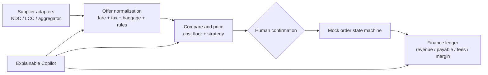

# AirBridge LCC Supply Chain Lab

An interview demo for the CTO role described in the brief: airline/LCC supplier connectivity, fare comparison, pricing strategy, order workflow, quantitative backtesting, accounting reconciliation, and an explainable operations copilot.

## Run locally

For the mock-data demo, open `index.html` in a modern browser. It has no build step or model API key. Orders are stored in that browser's `localStorage` and can be cleared from browser settings. To use FlightAPI search or the SIA NDC preparation page, run the local backend as described below.

## FlightAPI live flight search

The **实时航班搜索** page calls FlightAPI's one-way flight-price endpoint through the Node backend. The backend normalizes itineraries, flight legs, segments, carriers, and price-source options. The page supports price ceiling, stop-count and airline/source filters, plus sorting by price, duration, or departure time. Filtering and sorting run locally after the single upstream search, so they do not consume additional API calls. The FlightAPI key is read only from `FLIGHTAPI_KEY`; it is never sent to the browser.

Copy `.env.example` to `.env` and set `FLIGHTAPI_KEY` to the key from your FlightAPI dashboard. Start the server and open `http://localhost:8787/`, then choose **实时航班搜索**. Search inputs include IATA codes, date, passengers, cabin, currency and market region. FlightAPI's one-way endpoint currently costs two credits per API call according to its docs. Results are third-party aggregated prices and may need revalidation; this integration does not create orders, take payment, issue tickets, or constitute direct airline NDC connectivity.

GitHub Pages cannot keep a secret or run the backend. The demo uses a Tencent Cloud SCF Web Function, with `FLIGHTAPI_KEY` configured only in the function environment and `APP_ORIGINS=https://duoduohappy.github.io`. The public endpoint is configured in the `flight-api-base` meta tag in `index.html`; the browser calls the backend, which calls FlightAPI server-side. Never commit `.env`, put the API key in HTML, or share an unmasked key in screenshots or chat. CORS restricts browser origins but does not prevent direct HTTP clients from calling the public function URL; monitor FlightAPI credits and SCF usage.

## Singapore Airlines NDC preparation

The **新航 NDC** page adds a first vertical slice for Singapore Airlines NDC 21.3 `AirShopping`. It builds a one-way search request and sends it from a Node backend, so credentials never enter the browser. OrderCreate, payment, passenger identity data and ticket issuance are deliberately not implemented. The response is shown as raw XML until a partner-specific sample is available for a proper Offer normalization mapping.

To run the front end and secure local proxy together:

```powershell
Copy-Item .env.example .env
node backend/server.mjs
```

Open `http://localhost:8787/` and select **新航 NDC**. Without approved partner access the backend reports `not configured` and does not make an upstream request. Fill `.env` only with the endpoint, authentication header, Seller ID and Distributor ID provided by SIA/Amadeus after onboarding. Never put these values in `index.html`, GitHub Pages, source control, screenshots or chat. `.env` is ignored by Git.

The current public GitHub Pages site is static and cannot run the proxy or hold secrets. A public real-sandbox demo therefore also needs a separately deployed backend, restricted CORS to the Pages origin, and server-side secrets. The local `.env.example` already restricts browser calls to the Pages origin and local development origins. After deploying the backend, set the non-secret `<meta name="sia-api-base" content="https://YOUR-BACKEND-HOST">` in `index.html` to that backend's origin. The base URL is public configuration; credentials stay in the backend host's secret store.

SIA's published catalogue states that direct-connect partners must sign the tripartite NDA and submit the direct-connect application. The published catalogue is based on Amadeus Altéa NDC 21.3 and describes AirShopping, OfferPrice, OrderCreate and servicing operations. Implementation reference: [SIA NDC API catalogue](https://developer.singaporeair.com/ndc_api_catalogue), [SIA direct-connect resources](https://developer.singaporeair.com/page/ndc_resource), and the linked [AirShopping 21.3 implementation guide](https://developer.singaporeair.com/files/AmadeusAlteaNDC_AirShopping_21.3_Implementation_Guide_MAY24.pdf).

To serve the same files over HTTP instead:

```powershell
python -m http.server 8765
```

Then open `http://127.0.0.1:8765/` from this directory.

## Five-minute interview walkthrough

1. **Overview:** show the supply → offer normalization → pricing → human confirmation → finance flow and clearly identify all values as mock data.
2. **Supply:** inspect NDC/LCC/aggregator adapter cards and the Shop/Reprice/Order/Service capability contract.
3. **Pricing:** compare base fare, taxes/fees, baggage, refund conditions, supplier cost and suggested selling price. Switch the pricing strategy and change the target margin.
4. **Human-confirmed order:** select a fare and create a local simulated order. No airline call, payment or ticket issuance occurs.
5. **Quant strategy:** explain the synthetic baseline, risk limits and why the strategy is a recommendation, not live execution.
6. **Finance:** show order-level revenue, supplier cost, channel fees and gross margin.
7. **Copilot:** ask it to compare offers, explain pricing, summarize margin or check suppliers. The current implementation is a deterministic local router so the interview demo does not need an LLM key or consume tokens.

## Components represented



The prototype intentionally uses deterministic pricing and a local order simulator. The Copilot routes a small set of intents to read-only local functions. It does not run an LLM or place orders. The SIA NDC page is an opt-in backend integration scaffold; it does not return live airline data until authorized partner credentials and endpoint details are configured.

## GitHub references and integration boundary

- [open-ndc](https://github.com/open-ndc): study NDC standards/SDK structure.
- [airtechzone/ndc-graphql-api](https://github.com/airtechzone/ndc-graphql-api): limited alpha example for shopping, booking, order retrieval and cancellation.
- [TheBadBenny/flight-price-comparator](https://github.com/TheBadBenny/flight-price-comparator): comparison and source-normalization ideas; some sources are scrapers and must not be treated as production commercial APIs.
- [argonary/Dynamic-Programming-for-Airline-Revenue-Management](https://github.com/argonary/Dynamic-Programming-for-Airline-Revenue-Management): academic-style pricing/overbooking model, not a live pricing service.

No external repository code is copied into this demo. Its data is synthetic. A real connection requires supplier/airline authorization, credentials, sandbox certification, commercial terms, operational support, and correct ticketing/refund/settlement semantics. NDC is broader than flight search: it includes offer shopping, order creation and servicing, payment and refund flows. Public standard specifications do not grant production access.

## Interview framing

> I built a low-cost, static end-to-end prototype to make the target operating model concrete. It covers the technical seams from supplier adapters through pricing, human-approved orders and margin reconciliation. All suppliers, fares, backtest results and orders are simulated; the copilot is deterministic and no real ticket is issued. The next discovery gate is confirming the company's supplier contracts, API access, order-service coverage, settlement process and business constraints before choosing a production integration.

Do not describe the demo as a live airline integration, real quant strategy, production system, measured business lift, or autonomous trading Agent.

