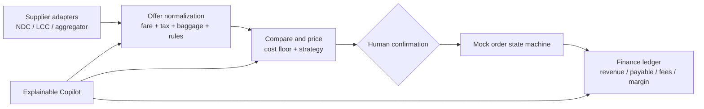

# AirBridge LCC Supply Chain Lab

An interview demo for the CTO role described in the brief: airline/LCC supplier connectivity, fare comparison, pricing strategy, order workflow, quantitative backtesting, accounting reconciliation, and an explainable operations copilot.

## Run locally

Open `index.html` in a modern browser. The demo is static, has no build step, external service, model API key, or token cost. Orders are stored in that browser's `localStorage` and can be cleared from browser settings.

To serve the same files over HTTP instead:

```powershell
python -m http.server 8765
```

Then open `http://127.0.0.1:8765/` from this directory.

## Five-minute interview walkthrough

1. **Overview:** show the supply → offer normalization → pricing → human confirmation → finance flow and clearly identify all values as mock data.
2. **Supply:** inspect NDC/LCC/aggregator adapter cards and the Shop/Reprice/Order/Service capability contract.
3. **Pricing:** compare base fare, taxes/fees, baggage, refund conditions, supplier cost and suggested selling price. Switch the pricing strategy and change the target margin.
4. **Human-confirmed order:** select a fare and create a local simulated order. No airline call, payment or ticket issuance occurs.
5. **Quant strategy:** explain the synthetic baseline, risk limits and why the strategy is a recommendation, not live execution.
6. **Finance:** show order-level revenue, supplier cost, channel fees and gross margin.
7. **Copilot:** ask it to compare offers, explain pricing, summarize margin or check suppliers. The current implementation is a deterministic local router so the interview demo does not need an LLM key or consume tokens.

## Components represented



The prototype intentionally uses deterministic pricing and a local order simulator. The Copilot routes a small set of intents to read-only local functions. It does not run an LLM or place orders.

## GitHub references and integration boundary

- [open-ndc](https://github.com/open-ndc): study NDC standards/SDK structure.
- [airtechzone/ndc-graphql-api](https://github.com/airtechzone/ndc-graphql-api): limited alpha example for shopping, booking, order retrieval and cancellation.
- [TheBadBenny/flight-price-comparator](https://github.com/TheBadBenny/flight-price-comparator): comparison and source-normalization ideas; some sources are scrapers and must not be treated as production commercial APIs.
- [argonary/Dynamic-Programming-for-Airline-Revenue-Management](https://github.com/argonary/Dynamic-Programming-for-Airline-Revenue-Management): academic-style pricing/overbooking model, not a live pricing service.

No external repository code is copied into this demo. Its data is synthetic. A real connection requires supplier/airline authorization, credentials, sandbox certification, commercial terms, operational support, and correct ticketing/refund/settlement semantics. NDC is broader than flight search: it includes offer shopping, order creation and servicing, payment and refund flows. Public standard specifications do not grant production access.

## Interview framing

> I built a low-cost, static end-to-end prototype to make the target operating model concrete. It covers the technical seams from supplier adapters through pricing, human-approved orders and margin reconciliation. All suppliers, fares, backtest results and orders are simulated; the copilot is deterministic and no real ticket is issued. The next discovery gate is confirming the company's supplier contracts, API access, order-service coverage, settlement process and business constraints before choosing a production integration.

Do not describe the demo as a live airline integration, real quant strategy, production system, measured business lift, or autonomous trading Agent.

